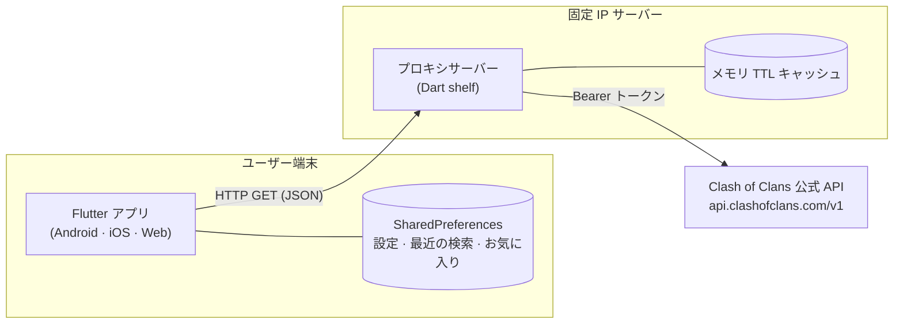
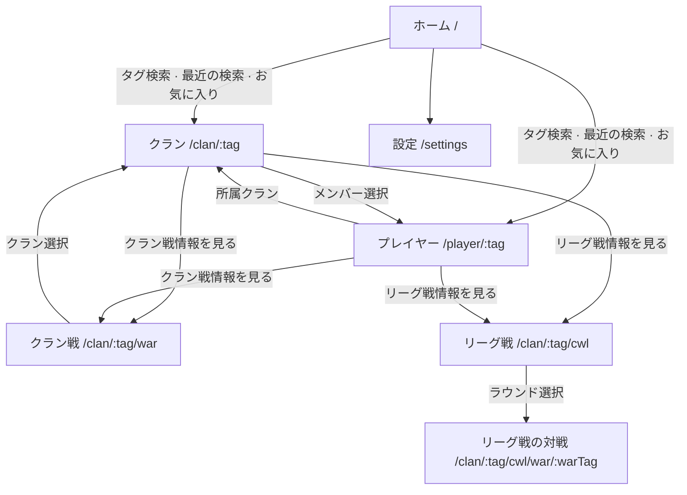
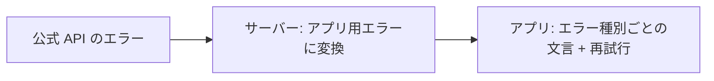

# 02 基本設計書

[한국어판](../kr/02_기본설계서.md)

| 項目 | 内容 |
|---|---|
| 基準 | Phase 0〜7 の実装内容 (2026-10-16) |
| 関連文書 | [01 要件定義書](01_要件定義書.md)、[03 詳細設計書](03_詳細設計書.md) |
| 状態 | 確定 (2026-10-16) |

## 1. システム構成

- **アプリ**は自前のプロキシサーバーだけを呼び出す。公式 API のトークンをアプリに入れないためである(NFR-05)。
- **プロキシサーバー**は公式 API を代わりに呼び出し、応答を加工せず JSON のままアプリに返す。同じリクエストはメモリに短時間保持して再利用する(NFR-04)。
- **公式 API のトークン**は登録した IP からのみ動作するため、サーバーは固定 IP のある場所で実行する。
- **DB はない。** そのため過去の記録は表示できない(01 要件定義書 6 章)。

## 2. リポジトリ構成 (Dart pub workspace モノレポ)
モノレポは複数のパッケージを一つのリポジトリに置く方式です。アプリとサーバーが同じモデルのコードを共用するために、このように分けています。

| パス | 役割 |
|---|---|
| `apps/mobile` | Flutter アプリ。画面、状態管理、多言語の文言 |
| `server` | プロキシサーバー。ルート、キャッシュ、エラー変換 |
| `packages/coc_models` | アプリとサーバーが共用する公式 API の応答モデルとタグ処理の関数 |
| `tool` | ゲーム画像の取得、レベル表の生成スクリプト |
| `docs/kr`、`docs/jp` | 段階別ドキュメント(韓国語版、日本語版) |

## 3. 技術選定
| 区分 | 選定 | 理由 |
|---|---|---|
| アプリ | Flutter | 一つのコードで Android、iOS、Web すべてに対応できる |
| 状態管理 | Riverpod 3 | 画面ごとのデータ取得・ローディング・エラー状態を一定の方法で扱える。テストで偽 API に差し替えやすい |
| 画面遷移 | go_router | URL(`/clan/2LCQYV0VL`)で画面を開けるため、Web でリンクから直接アクセスできる |
| HTTP (アプリ) | dio | タイムアウトの設定とエラー情報の処理が容易 |
| 端末保存 | shared_preferences | 設定や検索履歴のような小さな値の保存には十分 |
| サーバー | Dart shelf + shelf_router | アプリと同じ Dart 言語のため、モデルのコードをそのまま共用できる。軽量で構造が単純 |
| モデル | freezed + json_serializable | JSON ↔ オブジェクト変換のコードを自動生成し、ミスを減らす |
| サーバー実行 | Docker (`server/Dockerfile`) | AOT コンパイルした実行ファイルだけを含む小さなイメージで実行する |

## 4. 画面構成

### 4.1 画面一覧
| 画面 | アドレス | 主な機能 | 要件 |
|---|---|---|---|
| ホーム | `/` | タグ検索、最近の検索、お気に入り、非公式の表記 | FR-01〜05 |
| 設定 | `/settings` | 言語、テーマ | FR-06〜08 |
| クラン | `/clan/:tag` | ヘッダー、メンバー、戦争ログ、並べて表示 | FR-09〜13 |
| プレイヤー | `/player/:tag` | ヘッダー、統計、ヒーロー・装備・兵・呪文 | FR-14〜17 |
| クラン戦 | `/clan/:tag/war` | 状態、スコア、見通し、メンバー別の攻撃 | FR-19〜21 |
| リーグ戦 | `/clan/:tag/cwl` | 順位、ラウンド、メンバー成績 | FR-23〜26 |
| リーグ戦の対戦 | `/clan/:tag/cwl/war/:warTag` | 対戦詳細(クラン戦画面と同じ本文) | FR-24 |

アドレスのタグには `#` を付けない。例: クラン `/clan/2LCQYV0VL`、プレイヤー `/player/2PLCLPYV`

### 4.2 画面遷移

- 「クラン戦情報を見る」と「リーグ戦情報を見る」は同じ位置のボタンである。通常の戦争が準備日・戦闘日ならクラン戦のボタンを、通常の戦争がなくリーグ戦が準備日・戦闘日ならリーグ戦のボタンを表示する(FR-18、FR-22)。

## 5. サーバー API
アプリが呼び出す自前サーバーのアドレスです。すべて GET で JSON を返します。詳しい表は [03 詳細設計書](03_詳細設計書.md) 2 章にあります。

| アドレス | 内容 | キャッシュ |
|---|---|---|
| `/health` | サーバーの動作確認 | なし |
| `/clans/<tag>` | クラン情報 | 2 分 |
| `/clans/<tag>/warlog` | 戦争ログ | 5 分 |
| `/clans/<tag>/currentwar` | 現在のクラン戦 | 1 分 |
| `/clans/<tag>/currentwar/leaguegroup` | リーググループ | 5 分 |
| `/clanwarleagues/wars/<warTag>` | リーグ戦の対戦 | 1 分 |
| `/clans/<tag>/capitalraidseasons` | キャピタル襲撃 | 2 分 |
| `/leagues` | リーグ一覧(アイコン) | 24 時間 |
| `/players/<tag>` | プレイヤー情報 | 2 分 |

## 6. エラー処理

- サーバーは公式 API のエラーを、アプリが区別できるステータスコードと `reason` に変換して返す。サーバー設定の問題(トークン、IP)はユーザーの誤りではないため 502 に変換し、ログを残す。
- アプリはエラーを 7 種類(不正なタグ、存在しない、非公開ログ、リクエスト過多、メンテナンス中、ネットワーク、その他)に分けて文言を表示し、画面ごとに「再試行」ボタンを置く(NFR-02)。
- 自動リトライは無効にする。再試行しても意味のないエラー(404、403)でリクエストが繰り返されないようにするためである(NFR-03)。
- ボタンのような補助機能のエラーは画面に出さず、その部分だけを隠す。例: 戦争ログが非公開なら「クラン戦情報を見る」ボタンだけが表示されない。

## 7. データの保持
| 場所 | 内容 | 期間 |
|---|---|---|
| サーバーのメモリ | 公式 API の成功応答(最大 1000 件) | 1 分〜24 時間。サーバーを再起動すると消える |
| アプリのメモリ | 画面が表示しているデータ | 画面を閉じると消える |
| 端末(SharedPreferences) | 言語、テーマ、最近の検索(10 件)、お気に入り(100 件) | アプリを削除するまで |
| アプリに同梱 | レベル表(`assets/data/level_caps.json`)、分類表(`assets/data/item_groups.json`) | アプリ更新時に更新 |
| 各自のローカル | ゲーム画像(`apps/mobile/assets/game/`) | リポジトリには含めない(NFR-07) |

## 8. 設定値 (環境ごとに変える値)
| 名前 | 使用箇所 | 既定値 | 設定方法 |
|---|---|---|---|
| `COC_API_TOKEN` | サーバー | なし(必須) | 環境変数または `server/.env` (コミットしない) |
| `PORT` | サーバー | `8080` | 環境変数または `server/.env` |
| `API_BASE_URL` | アプリ | `http://localhost:8080` | ビルド時に `--dart-define=API_BASE_URL=...` |

- サーバーは環境変数を優先し、なければ `.env` ファイルを読む。
- 開発(macOS)、テストサーバー(Ubuntu)、本番リリース(AWS)は上記の値だけを変えて同じコードで実行する。デプロイ方法は今後 `06_デプロイ手順書` にまとめる。
