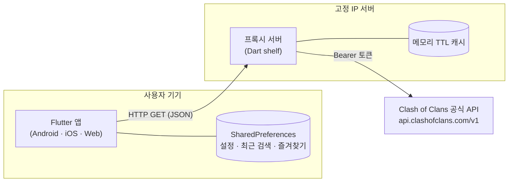
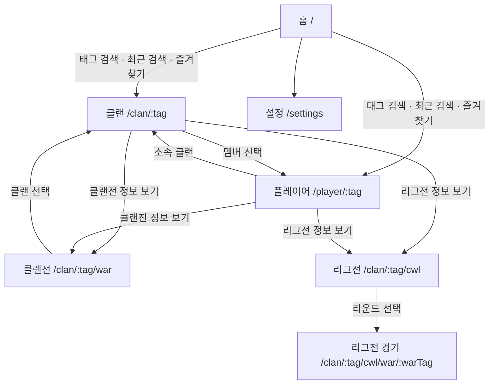
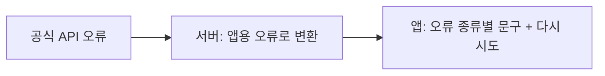

# 02 기본설계서

[日本語版](../jp/02_基本設計書.md)

| 항목 | 내용 |
|---|---|
| 기준 | Phase 0~7 구현 내용 (2026-10-16) |
| 관련 문서 | [01 요구사항정의서](01_요구사항정의서.md), [03 상세설계서](03_상세설계서.md) |
| 상태 | 확정 (2026-10-16) |

## 1. 시스템 구성

- **앱**은 우리 프록시 서버만 부른다. 공식 API 토큰을 앱에 넣지 않기 위해서다(NFR-05).
- **프록시 서버**는 공식 API를 대신 부르고, 응답을 가공하지 않고 JSON 그대로 앱에 돌려준다. 같은 요청은 메모리에 잠깐 보관했다가 다시 쓴다(NFR-04).
- **공식 API 토큰**은 등록한 IP에서만 동작하므로 서버는 고정 IP가 있는 곳에서 실행한다.
- **DB는 없다.** 그래서 지난 기록을 보여 줄 수 없다(01 요구사항정의서 6장).

## 2. 저장소 구조 (Dart pub workspace 모노레포)
모노레포는 여러 패키지를 저장소 하나에 두는 방식입니다. 앱과 서버가 같은 모델 코드를 함께 쓰려고 이렇게 나눴습니다.

| 경로 | 역할 |
|---|---|
| `apps/mobile` | Flutter 앱. 화면, 상태 관리, 다국어 문구 |
| `server` | 프록시 서버. 라우트, 캐시, 오류 변환 |
| `packages/coc_models` | 앱과 서버가 함께 쓰는 공식 API 응답 모델과 태그 처리 함수 |
| `tool` | 게임 이미지 받기, 레벨 표 만들기 스크립트 |
| `docs/kr`, `docs/jp` | 단계별 문서(한국어판, 일본어판) |

## 3. 기술 선택
| 구분 | 선택 | 이유 |
|---|---|---|
| 앱 | Flutter | 코드 하나로 Android, iOS, 웹을 모두 지원한다 |
| 상태 관리 | Riverpod 3 | 화면마다 데이터 불러오기·로딩·오류 상태를 일정한 방식으로 다룬다. 테스트에서 가짜 API로 바꾸기 쉽다 |
| 화면 이동 | go_router | URL 주소(`/clan/2LCQYV0VL`)로 화면을 열 수 있어 웹에서 링크로 바로 들어갈 수 있다 |
| HTTP (앱) | dio | 시간 초과 설정과 오류 정보 처리가 편하다 |
| 기기 저장 | shared_preferences | 설정과 검색 기록처럼 작은 값을 저장하기에 충분하다 |
| 서버 | Dart shelf + shelf_router | 앱과 같은 Dart 언어라 모델 코드를 그대로 함께 쓴다. 가볍고 구조가 단순하다 |
| 모델 | freezed + json_serializable | JSON ↔ 객체 변환 코드를 자동으로 만들어 실수를 줄인다 |
| 서버 실행 | Docker (`server/Dockerfile`) | AOT 컴파일한 실행 파일만 담은 작은 이미지로 실행한다 |

## 4. 화면 구성

### 4.1 화면 목록
| 화면 | 주소 | 주요 기능 | 요구사항 |
|---|---|---|---|
| 홈 | `/` | 태그 검색, 최근 검색, 즐겨찾기, 비공식 고지 | FR-01~05 |
| 설정 | `/settings` | 언어, 테마 | FR-06~08 |
| 클랜 | `/clan/:tag` | 헤더, 멤버, 전쟁 로그, 나란히 보기 | FR-09~13 |
| 플레이어 | `/player/:tag` | 헤더, 통계, 영웅·장비·부대·주문 | FR-14~17 |
| 클랜전 | `/clan/:tag/war` | 상태, 점수, 전망, 멤버별 공격 | FR-19~21 |
| 리그전 | `/clan/:tag/cwl` | 순위, 라운드, 멤버 성적 | FR-23~26 |
| 리그전 경기 | `/clan/:tag/cwl/war/:warTag` | 경기 상세(클랜전 화면과 같은 본문) | FR-24 |

주소의 태그에는 `#`을 빼고 쓴다. 예: 클랜 `/clan/2LCQYV0VL`, 플레이어 `/player/2PLCLPYV`

### 4.2 화면 이동

- "클랜전 정보 보기"와 "리그전 정보 보기"는 같은 위치의 버튼이다. 일반 전쟁이 준비일·전투일이면 클랜전 버튼을, 일반 전쟁이 없고 리그전이 준비일·전투일이면 리그전 버튼을 보여 준다(FR-18, FR-22).

## 5. 서버 API
앱이 부르는 우리 서버의 주소입니다. 모두 GET이고 JSON을 돌려줍니다. 자세한 표는 [03 상세설계서](03_상세설계서.md) 2장에 있습니다.

| 주소 | 내용 | 캐시 |
|---|---|---|
| `/health` | 서버 동작 확인 | 없음 |
| `/clans/<tag>` | 클랜 정보 | 2분 |
| `/clans/<tag>/warlog` | 전쟁 로그 | 5분 |
| `/clans/<tag>/currentwar` | 현재 클랜전 | 1분 |
| `/clans/<tag>/currentwar/leaguegroup` | 리그 그룹 | 5분 |
| `/clanwarleagues/wars/<warTag>` | 리그전 경기 | 1분 |
| `/clans/<tag>/capitalraidseasons` | 캐피탈 레이드 | 2분 |
| `/leagues` | 리그 목록(아이콘) | 24시간 |
| `/players/<tag>` | 플레이어 정보 | 2분 |

## 6. 오류 처리

- 서버는 공식 API 오류를 앱이 구분할 수 있는 상태 코드와 `reason`으로 바꿔 돌려준다. 서버 설정 문제(토큰, IP)는 사용자 잘못이 아니므로 502로 바꾸고 로그를 남긴다.
- 앱은 오류를 7가지(잘못된 태그, 없음, 비공개 로그, 요청 과다, 점검 중, 네트워크, 기타)로 나눠 문구를 보여 주고, 화면마다 "다시 시도" 버튼을 둔다(NFR-02).
- 자동 재시도는 끈다. 다시 해도 소용없는 오류(404, 403)에 요청이 반복되지 않게 하기 위해서다(NFR-03).
- 버튼처럼 보조 기능의 오류는 화면에 띄우지 않고 그 부분만 숨긴다. 예: 전쟁 로그가 비공개면 "클랜전 정보 보기" 버튼만 나오지 않는다.

## 7. 데이터 보관
| 위치 | 내용 | 기간 |
|---|---|---|
| 서버 메모리 | 공식 API 성공 응답 (최대 1000개) | 1분~24시간. 서버를 다시 켜면 사라진다 |
| 앱 메모리 | 화면이 보고 있는 데이터 | 화면을 닫으면 사라진다 |
| 기기(SharedPreferences) | 언어, 테마, 최근 검색(10개), 즐겨찾기(100개) | 앱을 지울 때까지 |
| 앱에 포함 | 레벨 표(`assets/data/level_caps.json`), 분류 표(`assets/data/item_groups.json`) | 앱 업데이트 때 갱신 |
| 각자 로컬 | 게임 이미지(`apps/mobile/assets/game/`) | 저장소에 올리지 않는다(NFR-07) |

## 8. 설정값 (환경별로 바꾸는 값)
| 이름 | 쓰는 곳 | 기본값 | 넣는 방법 |
|---|---|---|---|
| `COC_API_TOKEN` | 서버 | 없음(필수) | 환경변수 또는 `server/.env` (커밋하지 않음) |
| `PORT` | 서버 | `8080` | 환경변수 또는 `server/.env` |
| `API_BASE_URL` | 앱 | `http://localhost:8080` | 빌드할 때 `--dart-define=API_BASE_URL=...` |

- 서버는 환경변수를 먼저 보고, 없으면 `.env` 파일을 읽는다.
- 개발(macOS), 테스트 서버(Ubuntu), 본 릴리스(AWS)는 위 값만 바꿔서 같은 코드로 실행한다. 배포 방법은 이후 `06_배포절차서`에 정리한다.
